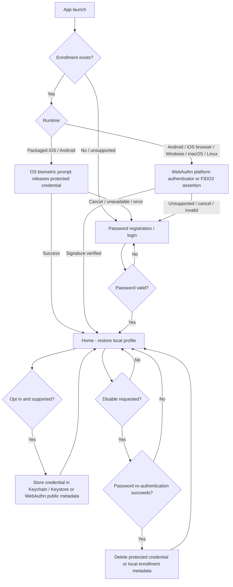

# Biometric unlock plan

## Goal

Add an optional device-local unlock for the packaged iOS and Android app and
supported Android, iOS, Windows, macOS, and Linux browsers. Face ID, Touch ID,
Android screen-lock verification, Windows Hello, or an available Linux
fingerprint/FIDO2 authenticator should make returning to this app easier
without replacing password authentication.

This is a **device-local app unlock**, not proof of identity to a server. The
current Vue 3 single-page app persists SQL.js in browser `localStorage` and has
no backend authentication. Packaged mobile apps use Capacitor and an
OS-protected credential. Browsers use WebAuthn in a secure context: the OS
authenticator or FIDO2 key holds the private key, while the app verifies each
assertion locally. Android browser enrollment requests a platform
authenticator. The credential provider may sync passkeys according to its own
settings; Bioform still restores only the browser's local profile.
A production backend and cross-device identity are out of scope. If those
become requirements, evaluate backend-verified passkeys as a separate
authentication feature.

## Scope

- Keep email/password registration and login as the initial account enrollment
  and the always-available recovery/fallback path.
- Let a signed-in user explicitly opt in to device-local unlock on a supported
  packaged iOS/Android app or a supported Android/iOS/Windows/macOS/Linux
  browser.
- On a later launch, offer unlock and restore the local profile only after a
  successful native biometric check or a locally verified WebAuthn assertion.
- Provide a password-based way to disable the feature and remove its
  device-local credential.
- Require a secure browser context and WebAuthn for browser unlock. Browsers without
  the API, supported OS, or secure origin continue to use password login.
- Linux sensor support varies by distribution, desktop environment, browser,
  and hardware; offer the real WebAuthn flow for available platform
  authenticators or FIDO2 keys and never report success without a verified
  assertion.

## User flows

### Mobile enrollment

1. The user registers or signs in with the existing email/password flow.
2. After successful authentication, offer an opt-in explanation. State that
   biometrics unlock this app on this device only and do not create or verify
   an online account.
3. Check native platform support and biometric enrollment through the OS API.
   If unavailable, unenrolled, or the user declines, keep password login
   unchanged.
4. On confirmation, create an app-generated, high-entropy, device-local
   resumable credential. Store it only in OS-protected secure storage with
   biometric-required access controls. Record only non-secret enrollment
   metadata in app preferences.
5. Confirm enrollment and keep the user signed in.

### Returning unlock

1. On a packaged mobile launch, check for an opt-in enrollment record and a
   usable native credential.
2. Prompt using the platform biometric dialog. Do not collect, store, or
   transmit biometric images, templates, or sensor data.
3. On success, retrieve/use the protected resumable credential to restore the
   local account context and show the home page.
4. On cancellation, lockout, unavailable biometrics, or any native/storage
   error, do not treat the user as authenticated. Show password login and a
   clear retry or recovery path.

### Browser enrollment and unlock

1. On a supported browser OS and secure origin, let the signed-in user
   opt in. Request a WebAuthn credential with user verification required and
   no attestation collection. The browser presents the actual OS platform
   authenticator (for example Android screen lock, Windows Hello, or Touch ID)
   or a compatible FIDO2 authenticator. Android requests a platform
   authenticator specifically.
2. Verify the registration challenge, origin, relying-party ID, and
   user-verification flags. Store only the credential ID and public key
   metadata in app preferences; the private key remains with the OS or
   authenticator.
3. On a later launch, request an assertion with a fresh random challenge and
   user verification required. Verify the challenge, origin, RP ID hash,
   user-presence and user-verification flags, credential ID, and signature
   against the saved public key before restoring the profile.
4. Unsupported browser APIs, insecure origins, unavailable authenticators,
   cancellation, malformed assertions, and verification failures return to
   password login. Linux FIDO2-device availability is discovered by the real
   registration/authentication operation because browsers do not expose a
   reliable preflight for attached external authenticators.

### Disable and fallback

- Keep a visible "Turn off biometric unlock" action in account/security
  settings.
- Require the existing account password to confirm disabling. Then delete the
  native secure-storage item and enrollment metadata; do not merely hide the
  option in the UI.
- Changing or removing enrolled biometrics should invalidate credentials
  configured to require the current biometric set. Fail closed and require
  password sign-in and explicit re-enrollment.
- Password sign-in remains available after biometric cancellation, lockout,
  OS changes, plugin failures, or loss of the device credential.
- Signing out clears the in-memory user/session. Decide during implementation
  whether sign-out also offers to disable biometric unlock; do not silently
  remove enrollment unless the user chooses that behavior.
- Desktop disable removes Bioform's public-key enrollment record after
  password re-authentication. The OS/browser credential manager owns the
  private passkey and may require the user to remove it separately; this
  feature does not claim to delete authenticator-managed credentials.
- WebAuthn user verification is controlled by the OS/authenticator and may use
  its configured device PIN/passcode or a FIDO2 key, not only a fingerprint.

### Flow diagram

The same password login remains available for initial enrollment, unsupported
devices, and every biometric failure or cancellation. Mobile credentials are
released by the OS; desktop assertions are verified locally. Successful
unlock only restores the local profile on this device.

## Architecture

- **Vue UI:** Add opt-in, unlock, error/fallback, and disable-confirmation
  states to the existing auth and account flows. Keep native prompts and
  WebAuthn UI in the OS/browser rather than collecting biometrics in the app.
- **Platform boundary:** Introduce a small authentication adapter with
  capability detection and operations for enroll, unlock, and disable. Browser
  unlock uses WebAuthn for supported Android, iOS, Windows, macOS, and Linux
  authenticators in a secure context; other browsers continue to use password
  login.
- **Native shell:** Package with Capacitor for iOS and Android. Use an actively
  maintained Capacitor plugin that provides biometric-protected Keychain /
  Keystore credentials and cryptographically gated reads. The implementation
  uses `@capgo/capacitor-native-biometric` with
  `AccessControl.BIOMETRY_CURRENT_SET` and a zero-second Android auth-validity
  window, so each read requires fresh authentication.
- **Browser:** Use WebAuthn in a secure context, relying on the
  platform authenticator for Windows Hello/macOS Touch ID and the browser's
  WebAuthn implementation for Android/iOS platform authenticators, Linux
  platform authenticators, or FIDO2 keys. In iOS Safari this is the web passkey
  prompt, not native-app Face ID access.
  Verify assertions locally with Web Crypto; do not claim support if the
  browser API or secure context is unavailable.
- **Secure credential:** On mobile, generate a random device-local resumable
  credential after password authentication and protect it using iOS Keychain
  access controls and Android Keystore plus
  `BiometricPrompt`/`CryptoObject` authentication. On desktop, keep the
  private key in the OS/browser authenticator and verify assertions with the
  stored public key. Never serialize a credential secret into SQL.js,
  `localStorage`, logs, analytics, or clipboard.
- **SQLite and preferences:** Keep biometric credentials out of SQL.js and
  localStorage. Mobile stores a random resumable credential only in Keychain /
  Keystore; ordinary Capacitor Preferences hold only the account ID and
  version. Desktop Preferences hold the account ID, credential ID, RP/origin,
  algorithm, and public key only; the authenticator retains the private key.
  Do not use the existing password hash as a resumable credential.
- **Boundary of trust:** The current app stores the password hash and profile
  locally and has no server-side identity check. A protected local credential
  can gate access to this installation, but cannot prove account ownership to
  another device or service. Do not describe this as secure remote
  authentication.

## Security and privacy considerations

- Biometrics authorize access to an OS-protected app credential; the app never
  handles biometric samples or templates.
- Keep secrets out of SQLite and browser storage. Secure-storage read/write,
  deletion, OS prompt, and plugin failures must be explicit and fail closed.
- Require successful password authentication before enrollment and before
  disabling; do not allow an unauthenticated UI state to enroll or remove a
  credential.
- Scope credentials to this app installation and account. Avoid logging
  credential values, password material, or sensitive native error payloads.
- Respect OS cancellation, lockout, biometric-enrollment changes, device
  passcode requirements, app reinstall, and secure-storage invalidation.
  Recovery always returns to password login; it must not silently bypass
  authentication.
- Treat local database contents as accessible to a device owner or a
  compromised device. This feature improves access control on a supported
  device but does not encrypt the SQL.js database or make the current
  local-only account system production-grade.
- Obtain clear opt-in consent and explain the local-only behavior. Do not
  enable biometrics by default.

## Assumptions and decisions

- Packaged mobile builds use Capacitor; Android and iOS browser unlock use
  WebAuthn. Browser support also covers Windows/macOS/Linux in a secure context.
- Password authentication remains the primary initial enrollment and fallback
  mechanism.
- Biometric unlock restores only a local app session/profile. There is no
  server to exchange a token with, revoke sessions on another device, or
  validate a passkey.
- Keychain/Keystore-protected app credentials and browser authenticator private
  keys are separate from SQL.js database contents.
- WebAuthn user verification is controlled by the OS/authenticator and may use
  its configured device PIN/passcode, not only a fingerprint. Passkey syncing
  is controlled by the browser or credential provider.

## Phased implementation and verification

### Phase 1: Platform and threat-model decision

- Add Capacitor packaging for iOS and Android, then verify the app builds and
  launches on both targets.
- Verify Android/iOS browser and desktop platform-authenticator detection and
  WebAuthn browser support. Treat Linux sensor/FIDO2 availability as
  environment-dependent and verify with actual enrollment, not a simulated
  result.
- On Android Chrome, confirm the home-page security link is discoverable and
  enrollment uses a platform authenticator over HTTPS; verify password fallback
  when the browser reports no enrolled screen lock/authenticator.
- On iOS Safari, verify WebAuthn/passkey availability on a supported OS and
  HTTPS origin; the browser presents Face ID/Touch ID/passcode verification,
  not the native-app Face ID API.
- Evaluate candidate plugins against Keychain/Keystore protection, biometric
  set changes, device passcode fallback, cancellation/lockout reporting,
  minimum OS versions, and maintenance status.
- Document supported platforms and decide whether device-credential fallback
  is permitted by product requirements.

**Exit check:** Native and desktop routes gate local profile restoration on
real OS/authenticator verification; no credential secret is stored in SQL.js
or browser storage.

### Phase 2: Native adapter and enrollment

- Add a typed JavaScript adapter for native and WebAuthn availability,
  enrollment, unlock, and disable.
- After successful password sign-in/registration and explicit consent, create
  the random device credential and protect it in platform secure storage.
- Handle unsupported devices, no enrolled biometric, permission denial,
  cancellation, and native errors without breaking password login.

**Exit check:** Enrollment is opt-in, platform secure-storage controls are
verified on iOS and Android, and no secret is written to SQLite,
`localStorage`, logs, or analytics.

### Phase 3: Returning unlock and recovery

- Add a returning-user biometric prompt on packaged mobile launches when a
  valid enrollment exists.
- Restore the local profile only after successful OS authentication and
  successful use of the protected credential.
- Route cancellation, lockout, biometric-set changes, missing credentials,
  and plugin/storage errors to password login with actionable messaging.

**Exit check:** The user cannot reach the authenticated home screen by
cancelling or failing the biometric prompt; password login still works in all
fallback states.

### Phase 4: Disable, lifecycle, and release validation

- Add password re-authentication before disabling, remove both protected
  credential and metadata, and test reinstall/sign-out/account-switch
  behavior.
- Verify on supported physical iOS and Android devices: successful and failed
  prompts, cancellation, lockout, changed biometric enrollment, absent
  biometrics, device credential policy, app relaunch, and password recovery.
- Run the production frontend build and focused tests. On supported desktop
  browsers, test
  Windows Hello, Touch ID, Linux platform authenticators and FIDO2 keys where
  available, cancellation, invalid signatures/origins, unsupported browsers,
  and password recovery. Review storage to confirm private keys and mobile
  credential secrets are absent from SQL.js, preferences, and logs.

**Exit check:** Document supported-device behavior and known limitations; the
feature remains disabled by default and has a tested password fallback.

## Out of scope

- Backend authentication, account synchronization, remote revocation, and
  biometric identity verification.
- Backend-verified passkeys for remote authentication. A future backend
  feature may use passkeys if the product needs cryptographic, cross-device
  identity.
- Storing or comparing biometric data in the app.
